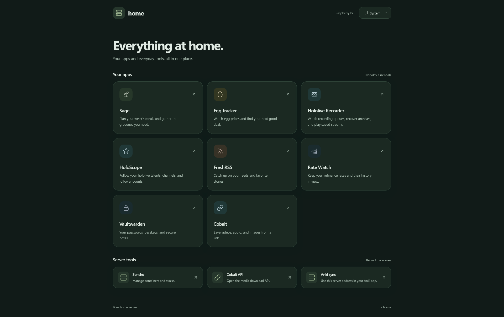
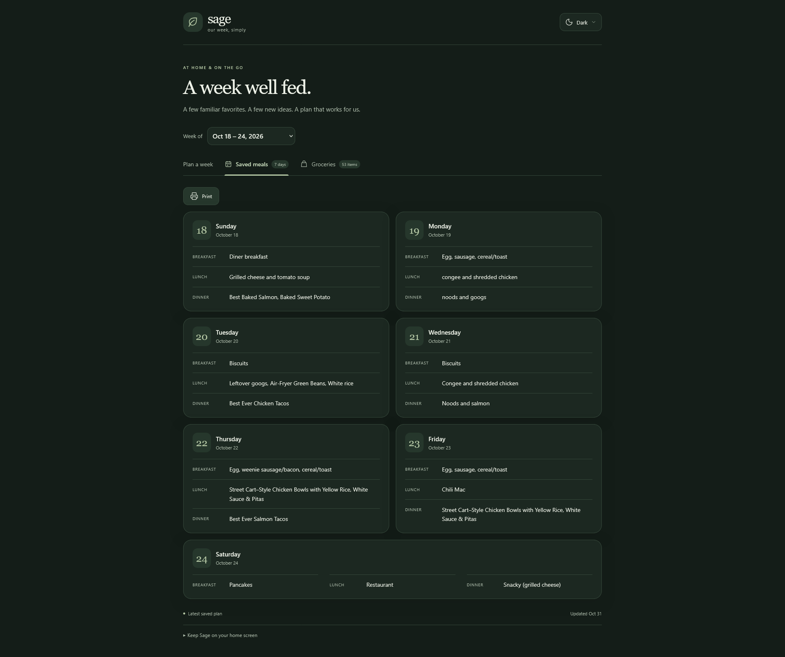
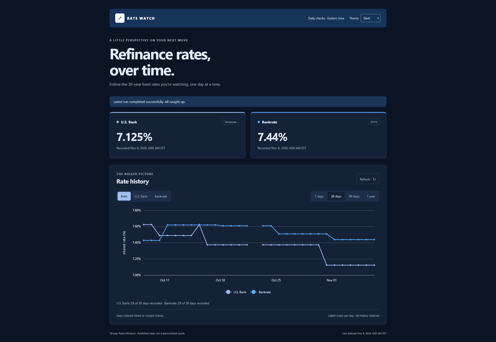
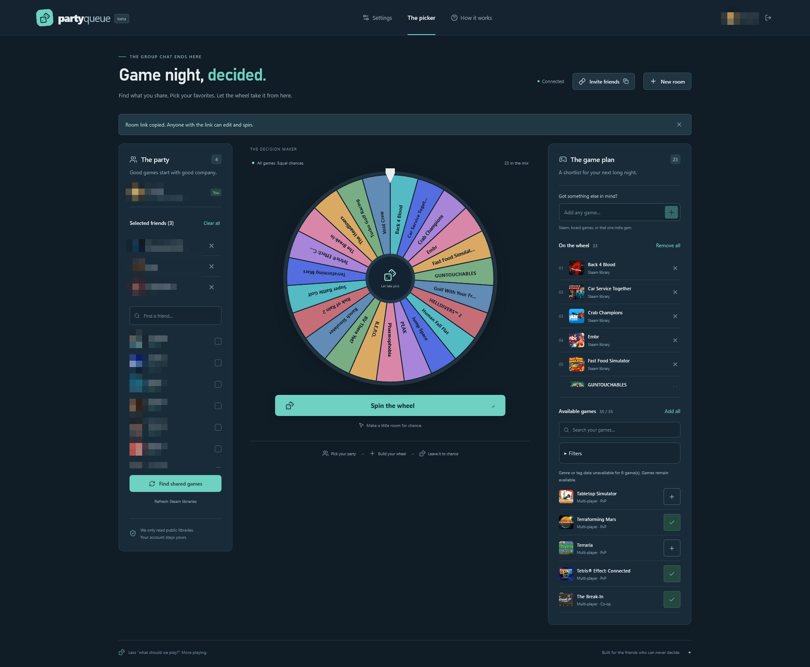

I want to give a little update since my last blog post. Something changed in the last few months for me. At my job, I was basically given the option to use AI, or "get left behind." They held a promotion over my head, effectively saying, "Use AI, or no promotion!" While I do not agree with this at all, I have to, unfortunately, go along with this. As you're probably well aware, inflation continues to rise while wages remain stagnant. I am in the unfortunate position of having to make a deal with the devil.

So, for the past few months, I have:
- Adopted an AI-first workflow
- Practiced AI agent orchestration
- Created GitHub Copilot plugins
- Created AI agent skills
- Created AI agent hooks
- Shared all of this newfound knowledge with my team
- Given internal AI workflow and agent talks

On the plus side, it's allowed me to iterate on things quickly at work as well as at home (I bought the $20/month Codex plan). As someone that experiences [time confetti](https://behavioralscientist.org/time-confetti-and-the-broken-promise-of-leisure/), this technology has actually been a sort of golden ticket to express and finish all of my ideas. I love writing little applications I find useful. I used to do it a lot more back in my 20s, but these days, I usually only have maybe an hour per week to dedicate to personal projects. Thanks to the ability to talk to Codex while I'm out on walks or making dinner, I can finish a lot of these things I merely started. I'll link and show off some of these apps at the [end of the post](#side-vibe-projects) in case you're interested in checking them out.

Having said all of that, I must mourn the death of my career. Let me clarify. I, thankfully, am still employed. However, the hobby and job I loved have died, and I am in mourning.

When I was in high school, I took my first formal programming class. We were learning the fundamentals of programming with C++. I immediately fell in love with programming, and I immediately fell in love with solving interesting problems with code. Due to my [impatience](https://thethreevirtues.com/) with computers, I liked to think about how to make things better and faster. My final project for that class was this little on-rails shooter (think [1942](https://en.wikipedia.org/wiki/1942_(video_game))). To this day, it's still one of my favorite projects, even though that thing was riddled with bugs. Fast forward to college: I worked my way through a degree in computer science, studying to be a software engineer. I started taking courses on various programming languages alongside the traditional data structures and algorithms, architecture, and other computer science subjects. I thoroughly enjoyed every programming class that I ever had, especially anything with a lab. I learned to write code in Java, C, C++, Python, Prolog, Ruby, among other languages. I couldn't get enough of learning programming languages and how they worked, whether compiled or interpreted.

My first job out of college was mobile and web app development (anyone else remember [Cordova](https://cordova.apache.org/)?). It remains some of my favorite work, and it's my favorite team with which I've ever worked. We solved a lot of neat and interesting problems and I learned so much during my time there. I learned so many new technologies and paved the way for my team in adopting new tech stacks and new software methodologies.

For the past 2-3 years, there's been talk of people losing jobs and replacing workers, including software engineers, with AI. I initially laughed this off because I saw the kind of work that these bots were putting out at the time. They could barely perform at a junior developer's level. Now, though, these models and agents are very capable. They're able to spit out prototypes and simple projects in about an hour or less, whereas it might take an individual or a few people a day or two to do the same amount of work. They've hacked entire [companies](https://en.wikipedia.org/wiki/OpenAI_rogue_agent_breach_of_Hugging_Face) and [governments](https://en.wikipedia.org/wiki/OpenAI_rogue_agent_breach_of_Medicare), and every day there's a new [brutal CVE](https://en.wikipedia.org/wiki/PHP2Shell) due to their persistence. Because of this, it seems like every software engineer has now turned into a sort of middle manager where they are managing several AI agents and orchestrating entire projects. It's incredible.

I've been in the tech space professionally for the better part of two decades now. It was always very obvious to me when someone got into this space for the money and not because they loved the programming. These kinds of folks were the people that were more obsessed with the destination than they were with the journey.

Now, I understand that everybody needs a job. Everyone needs a paycheck to be able to put a roof over their head and food on the table. However, I always found it hard to work with people that were disinterested in programming and just farted out whatever code made the thing work. These same people are now thriving in this environment. With AI agents, we now have the ability to:

- Get the clankers to design the software
- Get the clankers to write the software
- Get the clankers to debug the software
- Get the clankers to write the automated tests
- Get the clankers to manually test the software

And, I hate to say this, but I am now one of those people getting the clankers to do basically everything. Not because I want to, but because I have to. I don't want to use AI. I don't want to be in this situation, but at the end of the day, I'm a pragmatist that knows he has to do what he has to do in order to provide for his family and himself. The job market right now is horrific, and effectively, no one is hiring, and especially no one is going to hire an old frontend specialist.

All of this comes at a time when I am also mourning the loss of my father: the man who got me into programming and computers in the first place. One of my first memories is sitting down at a Commodore 64 and playing games on it. It's hard to know when things will feel better, let alone when they will get better.

I have a bit of hope that some things will change since we've seen the AI bubble pop in China. We're starting to see it here in the US, too, though I couldn't tell you what a "pop" would actually entail. Perhaps my hobbies in tech will become affordable again? (You can't build a decent PC for $500 anymore!) I don't imagine we can put this genie (LLMs) back in the bottle as much as I would like to.

I think there is some utility to LLMs, but, overall, they have been a net negative in my life. I don't know where to go from here, and I suppose I'm just ranting at this point, but I had to put my thoughts down on paper (or at least on a web page). I take a little bit of solace knowing that I'm not the only one that feels like this, but it doesn't really make anything any easier. Perhaps I will grow to enjoy this new way of working, at least to some extent. Hopefully this new era of software engineering will keep me gainfully employed for another 20 years or so. If not, I hope you can give me some suggestions on where to steer my career. I am nothing if not adaptable.

Do you work in tech? If so, how are you feeling about all of these changes? Feel free to let me know in the discussion box below. Thanks for reading, and I hope you have a good day.

## Side (vibe) projects

As promised, here's a list of the vibe coded apps I've had thrown together. The linked apps with "(PWA)" at the end are installable to your phone or tablet. (PWA = Progressive Web App)

- [Furigana Adder (PWA)](https://furigana-adder-pwa.web.app/): A Japanese helper app to add furigana above kanji
- [EV Charger Calculator (PWA)](https://ev-charge-calculator-216c6.web.app/): An app for calculating how much a charge for your EV will cost. It has some presets for vehicles and electricity rates, and will save your last inputs.
- [Timekeeper (PWA)](https://timekeeper-f5309.web.app/): An app for keeping track of how long since, or how long until a certain date. I use it for birthdays, anniversaries, and other important dates.

- A home screen for my home lab (all apps run on a Raspberry Pi 4)

- Sage: A meal planner helper application for my wife and me.

- Rate Watch: A dashboard that displays home loan interest rates over time. This actually started as a little notification system I built myself that would notify me in Discord if a rate fell below 6%, but I've since gotten the clanker to create a web page and show the graph of changes over time.

- Party Queue: An app that links with Steam to help you decide which game you want to play with your friends. You can pick from a list of your friends to match games you share, add those games to the spinner wheel, and then you let the wheel decide. I link this up with [tailscale funnels](https://tailscale.com/docs/features/tailscale-funnel) to share a room with friends so we can all pick and choose together.

